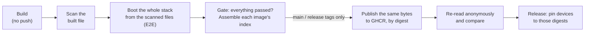
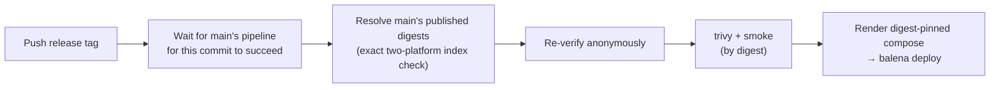

# How Vector Sigma images are built and published

A plain-language map of the image pipeline: what happens to an image between
a commit and a device, and why each step exists. For operating details see
[ghcr-promotion-runbook.md](ghcr-promotion-runbook.md); for the security
reasoning behind it, [ghcr-image-exposure-plan.md](ghcr-image-exposure-plan.md).

## The short version

Every image is **built once, scanned, tested, and then that exact file is
published**. Nothing is rebuilt between the scan and the registry, and the
published copy is re-downloaded and compared before anything uses it.

## Why not just `docker build --push`?

That would work, and it is how most projects publish. Four requirements make
this pipeline different:

1. **The images are public.** Anyone can pull them, so before anything is
   published each image is scanned for secrets and private network details
   (addresses, tailnet names, service maps).
2. **What ships must be exactly what was scanned.** If the scan and the push
   are two separate builds, nothing proves they produced the same thing. So
   the build writes a local file, the scan reads that file, the E2E runs that
   file, and publishing copies *that file's* bytes to the registry.
3. **Proof it arrived intact.** After publishing, a separate job with no write
   access re-downloads every image anonymously and checks it is byte-for-byte
   what was scanned.
4. **Test before publishing.** The whole registrar stack boots from the
   scanned images in a compose E2E before anything can be published.

## Why so many jobs

It is **9 images**, each built for **2 CPU architectures** (arm64 for the
devices, amd64 for CI and the E2E). The per-image steps fan out:

| Step | Jobs | What it does |
|---|---|---|
| Plan | 1 | Reads [`images.json`](../images.json), the one list of images |
| Stage + scan | 18 (9 × 2) | Builds without pushing, scans the exact bytes |
| E2E | 1 | Boots the stack from the scanned amd64 images |
| Gate | 1 | One pass/fail for everything; assembles each image's multi-arch index |
| Promote | 9 (main only) | Copies the scanned bytes to GHCR by digest, then tags |
| Verify | 1 (main only) | Anonymous re-read and compare of every image |

That's **22 jobs on a pull request** (including the unit tests) and **32 on
main**. A pull request never publishes anything. A **release** runs no build
at all, only its resolve, verify and deploy jobs (below).

## The tools

- **Build:** `docker buildx` to a local OCI file (`--output type=oci`), never
  `--push`, never a build cache.
- **Scan:** the in-repo content gate (`registrar/src/oci-gate`), which reads
  that file layer by layer.
- **Publish and verify:** [`regctl`](https://regclient.org), a standard
  registry tool, pinned to one version and checked against a known SHA-256
  before it runs (`scripts/install-regctl.sh`). `scripts/publish-image.sh`
  copies by digest, so the registry can only ever hold the scanned bytes.
  `scripts/verify-published.sh` re-reads them with no credentials at all.

## Where it lives

| File | Role |
|---|---|
| `.github/workflows/build-images.yml` | Pull requests (validate only) and main (publish) |
| `.github/workflows/_images.yml` | Build, scan, E2E, gate: shared by every caller |
| `.github/workflows/_promote.yml` | Publish + verify (main only) |
| `.github/workflows/_resolve.yml` | Releases: reuse main's verified images for the commit |
| `.github/workflows/release-*.yml` | Tag-triggered releases: resolve, then pin the fleet to the digests |
| `images.json` | The image list every workflow reads |

## Releases: build once, deploy many

A release **never rebuilds**. Every push to main already builds, scans, E2Es,
publishes and verifies that commit's images. A release is cut from such a
commit (`registrar-v*` / `devices-v*` tag), so it reuses them:

The release waits for main's run if it is still going (so you can tag right
after merging), and refuses if main's pipeline for that commit failed or never
ran. It holds no registry write permission at all. Devices are pinned to exact
digests, so the images a device runs are byte-for-byte the ones main scanned
and tested.

## Tags

Images are published **by digest** first; tags are labels added last, on
main only: `<commit-sha>` (the multi-arch index), `<commit-sha>-amd64`,
`<commit-sha>-arm64`. A release reads those tags to find the digests and then
uses the digests only.

## The switches

- Publishing only happens when the repository variable
  `VS_GHCR_PUBLISH_ENABLED` is `true`. Unset, every run is validate-only.
- Releases run only when someone pushes a `registrar-v*` or `devices-v*` tag.
