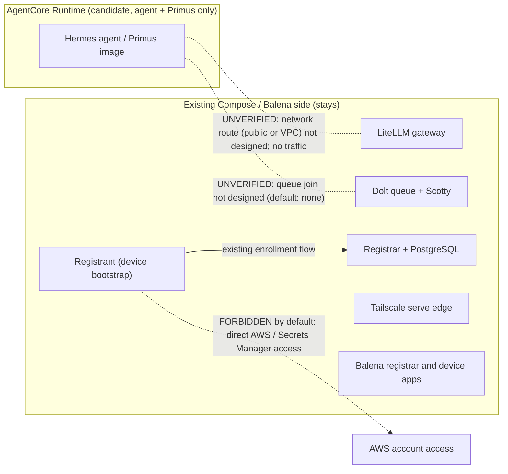
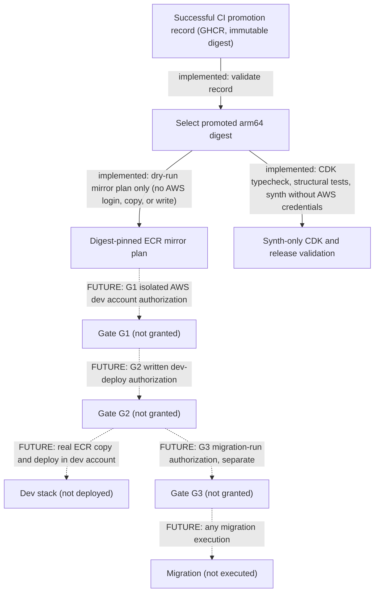
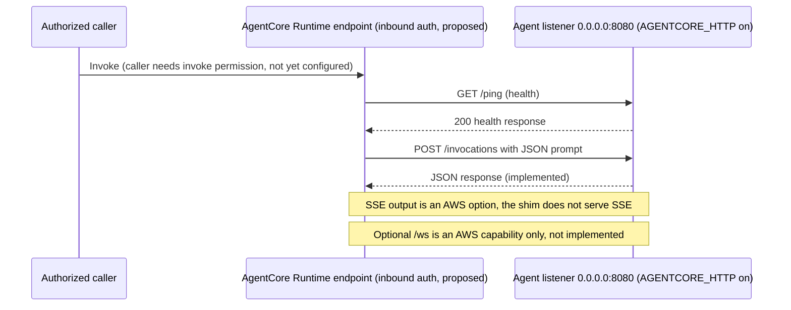
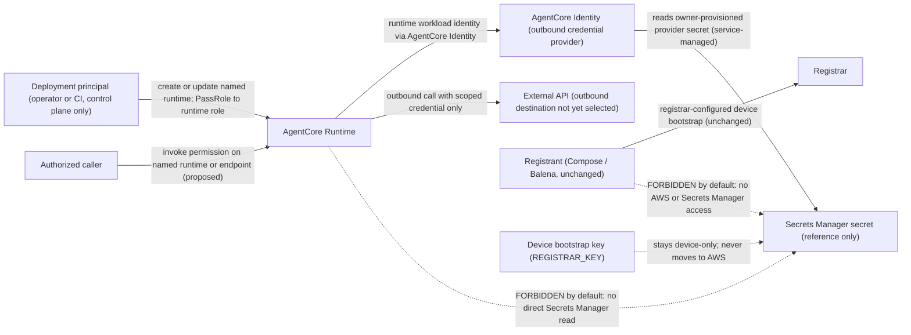
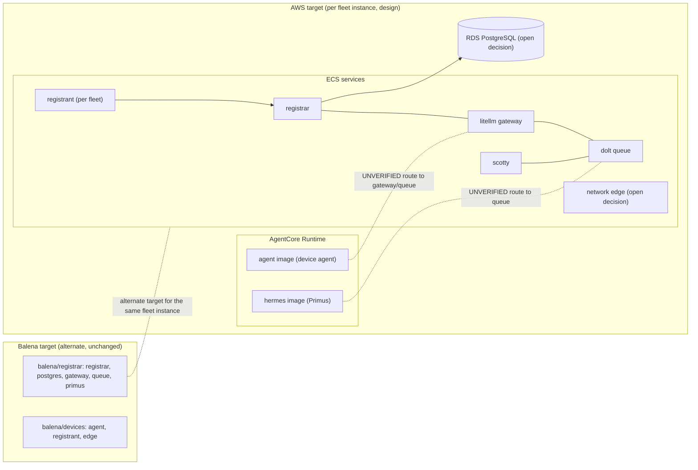
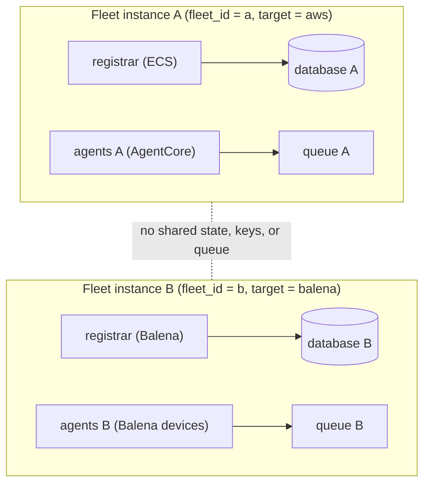
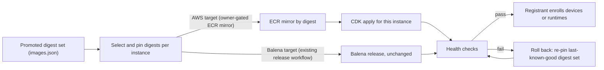

# Epic plan 0007: AgentCore platform adapter for Vector Sigma (AWS, CDK)

- **Status:** Owner-approved for plan commit and Beads intake — 2026-10-26. Boundary amended by owner direction 2026-11-07 (fleet-ops-1py.55.8, see "Superseding boundary" below). Design only; no migration, deployment, or device change is authorized by this amendment.
- **Owner decision:** Scope confirmed in Slack on 2026-10-26; the plan and board items do not authorize AWS deployment or migration execution.
- **Owner scope answers (decided, do not re-litigate):**
  1. Deliverable = platform adapter + deployment design only. Deployment execution deferred.
  2. AWS is parallel support; no Balena changes.
  3. CDK in TypeScript.
  4. First deploy/test environment = isolated AWS dev stack, never production, never fleet traffic.
  5. Least-privilege IAM + Secrets Manager for identity; the epic includes a written state/identity migration plan.
- **Reference inspected:** [aws-samples/sample-host-hermesagent-on-amazon-bedrock-agentcore](https://github.com/aws-samples/sample-host-hermesagent-on-amazon-bedrock-agentcore) — useful shapes (phased deploy, Secrets Manager pattern, agentcore invocation contract, cost/budget config), but its Python CDK + Hermes monkey-patch approach is NOT ours: Vector Sigma images are platform-neutral already, so the agent image stays one artifact with an env-switched entrypoint shim.

## Goal

Add `platforms/agentcore/` — a CDK-defined (TypeScript) AgentCore adapter that
runs the platform-neutral agent (and, in the design, primus) images on AWS
Bedrock AgentCore Runtime — while the registrar stack stays on the existing
compose/balena adapters. The epic ends at reviewed, buildable, CI-tested code
and docs. Nothing is deployed to AWS in this epic.

## Architecture (first cut per platforms/README.md "Adding AWS AgentCore (next)")

- **ECR mirror:** the current workflow validates a successful promotion record,
  selects the promoted arm64 digest, and produces an explicit ECR mirror plan
  only. It does not authenticate to AWS/ECR or copy images. Any real copy and
  target provisioning remain separately authorized.
- **Entrypoint shim:** the agent image includes an env-switched AgentCore
  **HTTP** invocation listener (`POST /invocations`, `GET /ping`, port 8080;
  JSON responses). It is not an A2A or MCP runtime shim. The classic
  Compose/Balena entrypoint remains the default path.
- **Identity:** the existing registrant remains on Compose/Balena and keeps
  its current registrar-configured device-bootstrap flow. No bootstrap key,
  bundle credential, or fleet identity moves to AWS. AgentCore Identity may
  reference a separately provisioned Secrets Manager credential for an
  AgentCore runtime's outbound calls; neither the registrant nor the runtime
  receives direct Secrets Manager access by default. This follows
  [`platforms/agentcore/README.md`](../../platforms/agentcore/README.md) and
  [`platforms/agentcore/MIGRATION-PLAN.md`](../../platforms/agentcore/MIGRATION-PLAN.md).
  Any change to the registrant, bootstrap flow, bundle contract, or Balena
  behavior is outside this scope and requires a separately owner-approved
  scope change.
- **Deploy definition:** a TypeScript CDK stack and tag-validation workflow
  exist. The stack is synth-only, uses placeholder/default references, and
  has structural tests; workflows do not deploy or publish to ECR.
- **What stays off AWS:** registrar, registrant, PostgreSQL, gateway, queue,
  Scotty, and existing device applications. The registrar stack remains on
  Compose/Balena. AgentCore hosts agent + Primus only.

### Diagram 1 — deployment boundary and placement

Legend: solid = current/implemented placement; dashed = proposed or unverified route (not an established connection); the forbidden edge is labelled explicitly.

### Diagram 2 — artifact and authorization path

Implemented steps are shown in solid lines. Steps marked "FUTURE" are not authorized and not implemented; no AWS login, copy, or write is performed by anything in this epic.

### Diagram 3 — invocation contract

The selected protocol is AWS HTTP (container listener `0.0.0.0:8080`, ARM64). It is distinct from A2A (`:9000`) and MCP (`:8000`), which are not used by this adapter. `/ws` is an optional AWS capability and is not implemented by Vector Sigma.

### Diagram 4 — identity and secret flows

Solid flows are part of the design. Dotted edges labelled FORBIDDEN are explicitly disallowed by default; dotted edges labelled UNVERIFIED or proposed are not established.

## Superseding boundary (owner direction, 2026-11-07)

This section supersedes the earlier "AWS is parallel support; registrar stays
on Compose/Balena" boundary for **design purposes**. The earlier boundary
limited AWS to agent and Primus runtime hosting. Under the new direction:

- **Every service needs an AWS target.** Each service in the fleet is
  classified below as AgentCore Runtime (agents), ECS (services unsuited to
  AgentCore), or a named managed AWS service where that fits better.
- **Balena remains an alternate deployable fleet target.** Balena is not
  removed. A fleet instance chooses its target (AWS or Balena); the design must
  support both.
- **Registrar is ECS** in the AWS environment.
- **Design only.** This amendment authorizes no migration, no AWS account
  access, no deployment, and no change to current Balena or device deployments.
  The AWS target has no Raspberry Pi hardware; device workloads stay on their
  current platform until a separate, owner-approved decision says otherwise.

What this does not change: the registrant bootstrap flow, the device bootstrap
key (`REGISTRAR_KEY`), the bundle contract, and Balena behavior. Those remain
out of scope and need a separate owner-approved decision.

## Target classification (every service)

Service names come from `stack/registrar.yaml` and `platforms/balena/devices`.
"Target" is the AWS placement design. "Balena" is the alternate target, which
stays available for every row.

| Service | Role | AWS target (design) | Balena alternate | Notes |
|---|---|---|---|---|
| `agent` (device agent image) | Hermes device agent | AgentCore Runtime | `balena/devices` (current) | Needs the HTTP entrypoint shim behind an env switch. Not a device migration. |
| `hermes` (primus coordinator) | Primus coordinator | AgentCore Runtime | `balena/registrar` (current) | Same image family as `agent`; same shim requirement. |
| `registrar` | Registrar API + admin console | ECS service | `balena/registrar` (current) | Set by owner direction 2026-11-07. Keeps its own bundle and identity authority. |
| `postgres` | Registrar database | Amazon RDS for PostgreSQL | Container in `balena/registrar` | Managed-service choice to confirm (RDS vs. self-run on ECS). Open decision. |
| `litellm` | Model gateway, virtual keys, `/a2a/*` mesh | ECS service | `balena/registrar` (current) | Stateful config and keys stay in the fleet identity plane. |
| `dolt` | Queue (`vs_ops`) | ECS service with EFS volume | Container in `balena/registrar` | Dolt state is durable; EFS sizing and backup are open. |
| `scotty` | Queue dashboard | ECS service | `balena/registrar` (current) | Stateless frontend over Dolt. |
| `registrant` | Device bootstrap service | Open decision: device-side only, or ECS per instance | Balena device (current) | Keeps the device-bootstrap flow. Gains no AWS credentials by default. Placement needs an owner decision. |
| `tailscale` / `tailscale-devices` | Network edge | ECS service, or none | Balena (current) | Tailnet membership on AWS is an open decision. Default: no runtime joins the tailnet. |
| `registrant-own` | Primus/master device self-registrant | Not deployed on AWS | `balena/registrar` (current; always-on, `restart: always`, no profile). On Balena the supervisor supplies `BALENA_DEVICE_UUID` and `REGISTRAR_KEY` as device variables. The explicit-env form is the self-host Compose path. | Stays as it is. Not moved by this design. |

**Open decisions (not resolved here):**

1. `postgres`: RDS for PostgreSQL vs. self-run on ECS. Affects backup, cost,
   and migration. Needs an owner decision.
2. `dolt`: EFS or another durable store, and the backup and restore design.
3. Tailnet participation of AWS-hosted services, and how they reach the
   tailnet-only gateway/queue endpoints.
4. Whether `agent` and `hermes` on AgentCore may use the public network or
   need a VPC route to ECS-hosted services.
5. Which fleet instance first targets AWS. No device is moved by this plan.

### Diagram 5 — service placement by target

## Parameterized fleets (N independent instances)

The whole-fleet deployment is defined once and instantiated N times. Each
instance is a **fleet instance** with its own parameters:

| Parameter | Meaning | Isolation rule |
|---|---|---|
| `fleet_id` | Stable name, for example `vs-prod-a` | Unique across all instances. Drives resource naming and tags. |
| `target` | `aws` or `balena` | Chosen per instance. Each target has its own adapter. |
| `region` / `account` | AWS placement (AWS target only) | One account per instance or a shared account with a per-instance boundary. The choice is open (see below). |
| `balena_fleets` | Balena app names (Balena target only) | Each instance maps to its own fleet names. |
| `images` | Promoted GHCR digests from `images.json` | Pinned by digest. No floating tags. |
| `gateway_url` / `queue_endpoint` | Instance-local endpoints | Never shared with another instance. |

**Isolation.** No two instances share a registrar database, queue (Dolt
database), bundle store, gateway key set, or device identity space. Instance
A must not be able to read or write instance B's state. The VS fleet's
cross-fleet rule (no shared queue writes with the origin fleet) applies to
every instance.

**Identity and bootstrap per instance.** Each instance has its own registrar
and its own bootstrap keys. Device bootstrap (`REGISTRAR_KEY`) is generated and
held by that instance's registrar. AgentCore runtimes, ECS services, and
Balena devices each receive identity only from their own instance's registrar
or from AgentCore Identity for outbound calls. No instance receives another
instance's keys.

**Bootstrap order** (per instance, design): the registrar and its database come
up first. Then the gateway and queue. Then the registrant, which enrolls
devices or runtimes. Then the agents and Primus. This ordering is design
intent to verify at implementation time.

### Diagram 6 — fleet instances and isolation boundaries

## Deployment and rollback (design)

**Deploy.** Deployment is per instance and per target. The path is:

1. Select a promoted image set from `images.json` and pin each component by its
   arm64 digest.
2. For the AWS target: mirror the digests to ECR (a separate, owner-gated step),
   then apply the CDK definition for that instance. For the Balena target:
   use the existing release workflows, unchanged.
3. Run the instance's health checks, then enroll the registrant.

**Rollback.** Rollback is by digest, not by rebuild. Each instance records the
last-known-good digest set. Rolling back means re-pinning that set and
redeploying the same bytes. AgentCore keeps runtime versions and endpoints,
so the design uses endpoint re-pointing to roll back an agent. The ECS services
keep their previous task definition revision. Balena rolls back through its
own release history.

**Limits.** No migration runs as part of a deploy. Database rollback is a
separate, owner-gated decision, because schema and data changes are not
reversible by re-pinning an image.

**Open decisions:** the exact rollback trigger and approval, and how to
coordinate a rollback across instances that share nothing.

### Diagram 7 — deploy and rollback flow

## Stages (children, in dependency order)

1. **Design doc — completed at the current main base:** `platforms/agentcore/README.md` records current AgentCore requirements, IAM boundaries, and open account-dependent questions. It places the registrant on the existing Compose/Balena control plane, keeps its current registrar-configured device bootstrap flow, and gives neither the registrant nor the runtime direct Secrets Manager access. Secrets Manager-backed credentials are an optional AgentCore Identity mechanism for separately provisioned runtime outbound credentials; they do not replace the device bootstrap key. Any request to change the registrant, device bootstrap flow, bundle contract, or Balena behavior is a separately owner-approved scope change. No infrastructure is deployed.
2. **Migration plan doc — completed at the current main base:** `platforms/agentcore/MIGRATION-PLAN.md` inventories state and identity boundaries and defaults to no migration. Device bootstrap identity stays device-only; any future runtime identity is a separate design and owner-gated. It is documentation only and authorizes no execution.
3. **Entrypoint shim — implemented at the current main base:** the agent image has an env-switched HTTP listener (`POST /invocations`, `GET /ping`, port 8080, JSON responses); the existing Compose/Balena entrypoint remains the default. It is not an A2A or MCP listener. Repo tests exercise the shim and classic path.
4. **ECR mirror — dry-run planning only:** the workflow validates a successful promotion record and produces a digest-pinned mirror plan; it performs no AWS/ECR login, copy, or write. Real ECR provisioning/copy remains separately authorized.
5. **TypeScript CDK app — synth-only:** the app defines the AgentCore runtime with least-privilege image-pull permissions and structural assertions. The secret ARN is a placeholder/reference parameter only; it is not wired to the registrant or runtime as direct Secrets Manager access. CI typechecks, tests, and synthesizes without AWS credentials; no deploy job exists.
6. **Release validation workflow — implemented at the current main base:** tag-triggered tests and synth only. It does not publish to ECR or deploy. Any real deployment remains a separate, owner-authorized action.

## Standing limits (bind every child)

- No AWS account access, no `cdk deploy`/diff against a real account, no
  credential creation or rotation, no AWS CLI configuration on any host —
  these need separate owner authorization.
- **No Balena or device identity changes in this epic:** no device application,
  registrant, device-bootstrap flow, bundle contract, Balena fleet, or existing
  release workflow changes. Any such change requires a separate,
  owner-approved scope decision before implementation.
- No production or fleet-facing traffic in this epic, ever.

## Owner gates (after the epic)

1. AWS account + billing for the isolated dev stack (needed first if
   deployment is later authorized; stage 4's real run and any deploy waits on
   it).
2. A written "deploy the dev stack" go — separate from this epic's close.
3. Migration execution — separate authorization; the plan doc inside this
   epic authorizes nothing.

## Risks / honesty

- AgentCore's exact port/protocol/arch requirements are summarized secondhand
  here; stage 1 must verify against current AWS docs before design merge.
- Nothing infra-touching is verifiable without an AWS account — workflow and
  CDK children must state plainly what was synth-tested vs never exercised.
- Cost: even a dev-stack AgentCore runtime + Bedrock use is nonzero; budget
  caps (mirror the reference repo's daily cap pattern) belong in the stage 5
  config when deployment is separately authorized.
- Current `main` contains design documents and synth-only validation
  infrastructure, not a deployed AgentCore service. The migration plan and
  adapter design explicitly keep the registrant on Compose/Balena and do not
  replace or export its device-bootstrap identity to AWS. This PR aligns the
  original epic plan with that settled design; it authorizes no implementation,
  credential changes, AWS account access, or deployment.